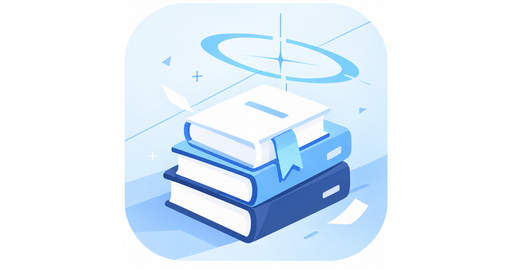
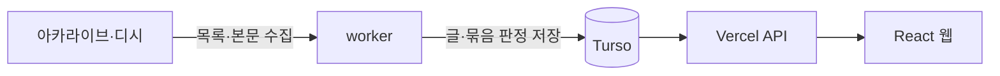

# 블아 번역 탭 모아보기

**아카라이브와 디시인사이드의 블루 아카이브 번역글을 한 목록에서 볼 수 있어요.**



번역글을 보려면 아카라이브 블루아카이브 채널의 번역 탭과 디시 블루 아카이브 갤러리의 번역 말머리를 따로 돌아봐야 했어요. 같은 번역이 양쪽에 올라오면 두 번 보게 되고요. 이 사이트는 두 곳의 새 글을 시간순으로 한 목록에 모으고, 같은 번역은 하나로 묶어서 보여 줘요.

> 만든 과정과 판단 근거는 [개발기](https://app.notion.com/p/13-418225b4c5c780cb8d73de07f241da1c)에 적었어요. 구현 요약은 아래 [어떻게 만들었나요](#어떻게-만들었나요)에 있어요.

## 이런 걸 할 수 있어요

- **두 사이트를 한 목록으로**: 아카·디시 번역글을 시간순으로 섞어서 보여 줘요. 목록은 5분마다, 그리고 다른 탭에 있다가 돌아올 때 새로 고쳐져요.
- **같은 번역은 한 묶음으로**: 같은 원작을 번역한 글이 양쪽에 올라오면 하나로 묶어요. 묶음에서 아카 원문과 디시 원문 중 원하는 쪽으로 갈 수 있어요.
- **읽은 글 표시**: 한 번 연 글은 읽음으로 표시돼서, 어디까지 봤는지 바로 알 수 있어요.
- **검색과 추천컷**: 제목으로 검색하고, 추천 수가 일정 이상인 글만 볼 수 있어요.
- **원작 작가 모아보기와 팔로우**: 번역글에 달린 원작 출처(픽시브·X 등)에서 원작 작가를 찾아 보여 줘요. 좋아하는 작가를 팔로우하면 그 작가의 작품 번역만 골라 볼 수 있어요.
- **창작 탭**: 양쪽 창작 게시판의 글도 같은 방식으로 모아 보여 줘요.

## 운영 원칙

이 사이트는 두 커뮤니티의 글을 모아 보여 주는 파생 서비스예요. 원본 게시판과 커뮤니티에 해가 되지 않도록 아래 원칙을 지켜요.

1. **트래픽을 최소로 유지해요.** 요청 간격을 지키면서 수집하고, 일반 사용자가 게시판을 둘러보는 정도보다 많은 트래픽을 만들지 않아요.
2. **원문을 대신하지 않아요.** 제목·작성자·추천 수 같은 목록 정보와 원문 링크만 보여 주고, 본문과 이미지는 저장하지 않아요. 글을 누르면 항상 원래 게시판으로 이동해요. 원문의 조회수와 반응을 가져오지 않도록 이 사이트에는 추천이나 댓글 기능을 만들지 않아요. 추천과 댓글은 원문에 남겨 주세요.
3. **문제가 생기면 바로 고치고, 필요하면 그만둬요.** 문제를 알려 주시면 바로 서비스를 고쳐요. 감당하기 어려운 문제라면 서비스를 중단해요.
4. **허가를 받고 공개했어요.** 공개 전에 아카라이브 블루아카이브 채널과 디시인사이드 블루 아카이브 갤러리의 관리자에게 프로젝트를 보여 드리고 허가를 받았어요.

문제가 있거나 내려 주기를 원하시면 [이슈](https://github.com/spoyodevelop/ba-translation-board/issues)로 알려 주세요.

## 개인정보

- 읽은 글 기록과 팔로우한 작가는 **지금 쓰는 브라우저에만** 저장돼요. 서버로 보내지 않아서 다른 기기와 공유되지 않아요.
- 방문 통계(Google Analytics)는 사이트를 어떻게 쓰는지만 익명으로 집계해요. 어떤 글을 읽었는지, 무엇을 검색했는지, 어떤 작가를 팔로우했는지는 보내지 않아요.

## 어떻게 만들었나요



worker는 직접 운영하는 서버에서 돌아가요.

### 번역 탭: 본문의 원작 출처로 같은 번역 묶기

처음에는 제목의 의미를 비교하는 모델로 같은 번역을 판정했어요. 하지만 번역자마다 제목을 새로 지어서 표본의 1/3이 오판이었고, 프롬프트를 다듬은 뒤에도 1/5이 남았어요. 그렇다고 모든 글의 이미지를 비교하면 원본 사이트에 요청이 크게 늘어나요.

번역글 대부분은 본문에 원작 링크(X, 픽시브)를 남긴다는 점을 이용해, 확실하고 값싼 근거부터 확인해요.

1. **출처 ID**: 본문 HTML을 한 번만 읽어 출처 ID를 뽑아 캐시해요. 반대편에 같은 ID가 있으면 바로 묶고 끝내요.
2. **제목 판정**: 출처가 없는 글만, 가까운 시간대의 후보와 제목을 비교해요. 확률 0.95 이상인 확실한 경우만 묶어요.
3. **이미지 비교**: 그래도 정해지지 않으면 제목이 조금이라도 비슷한 후보만 골라 첫 이미지의 pHash를 비교해요.

- 번역글 3,811개를 3,054줄로 줄였어요(약 20%).
- 묶인 연결의 96.5%가 출처 ID만으로 정해졌어요.
- 4일간 본문을 읽은 277개 중 90%는 이미지 단계로 가지 않았고, 실제로 받은 이미지는 41장이었어요.

### 창작 탭: 본문을 열지 않고 목록 정보만으로

창작 탭은 글이 번역 탭의 약 3.3배라 본문을 열면 원본 사이트 요청도 그만큼 늘어나요. 양쪽 글 523쌍을 직접 판정해 보니, 같은 글은 양쪽에 올라온 시간 차가 중간값 2분이었고 같은 작가의 다른 글은 187분이었어요. 그래서 목록에 있는 작가·시각·제목만으로 판정해요.

- 같은 작가가 60분 안에 제목이 비슷한 글(유사도 0.5 이상)을 양쪽에 올리면 묶어요.
- 작가를 알 수 없어도 120분 안에 제목이 거의 같으면(유사도 0.7 이상) 묶어요.
- "9화"와 "10화"처럼 회차가 다르면 묶지 않아요. 한 글은 반대편의 한 글하고만 짝을 지어요.

523쌍으로 검증한 결과 정밀도 98.8%, 재현율 96.2%였어요. 다른 글을 잘못 합치면 사용자가 그 글을 아예 못 보게 되므로, 애매한 쌍은 묶지 않고 정밀도를 우선했어요. 원본 사이트에 추가 요청이 생기지 않아요.

### 수집이 원본 사이트에 부담을 주지 않도록

- 429 응답을 받으면 서버가 알려 준 시간만큼 기다리고, 403이나 차단 안내를 받으면 그 수집을 바로 멈춰요.
- 실패한 작업은 30초 뒤에 다시 시도하고, 간격을 두 배씩 늘려 최대 5분까지 기다려요.
- worker는 작업을 임대해서 처리하고, DB에 쓸 때마다 같은 트랜잭션에서 소유권을 확인해요. 소유권을 잃은 worker가 다음 worker의 결과를 덮어쓰지 않아요.

### 코드 둘러보기

| 위치 | 내용 |
|---|---|
| `src/sources/extractSources.ts` | 본문에서 출처 ID 추출 |
| `src/worker/grouping.ts` | 번역글 판정 단계 |
| `src/grouping/creativeMatch.ts` | 창작글 판정 규칙 |
| `src/sources/imageHash.ts` | pHash 구현 |
| `src/sources/failurePolicy.ts` | 수집 실패 처리 |
| `src/worker/lease.ts` | 작업 소유권 확인 |
| `src/worker/runtime.ts` | 작업 일정과 재시도 |

```bash
npm test
```

